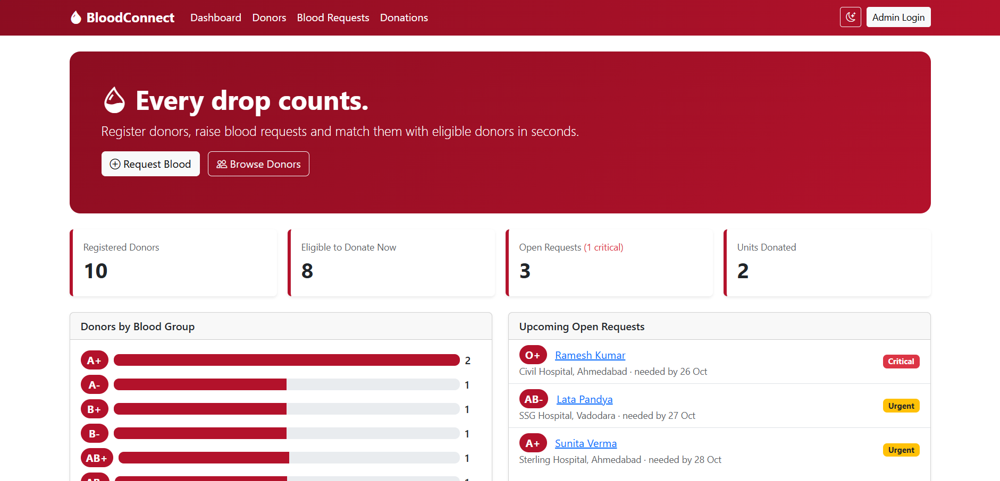
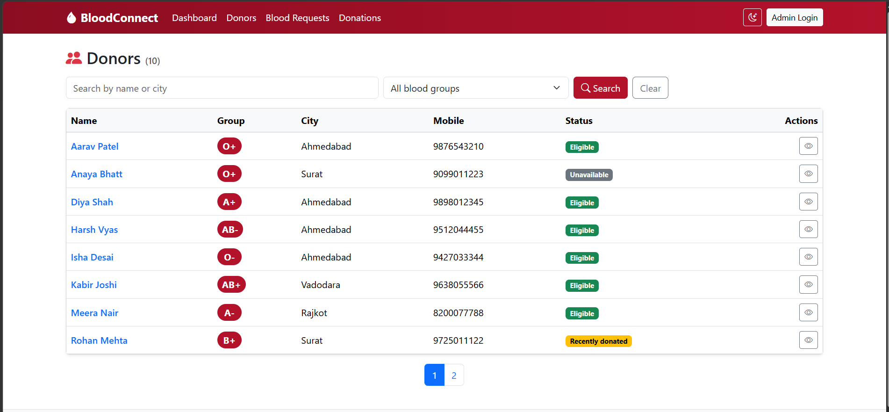
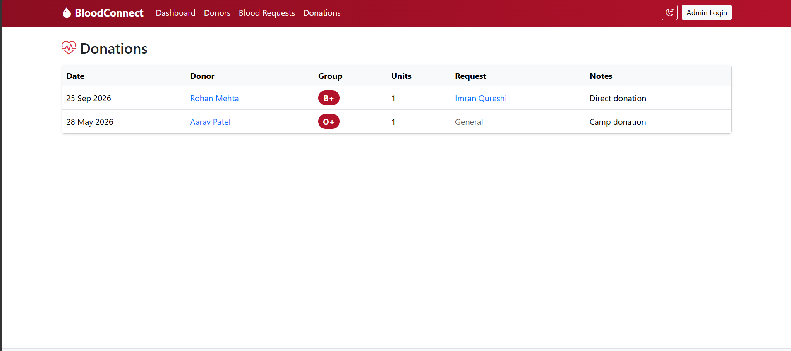

# BloodConnect – Blood Donation & Request Management System

A web-based application developed using **ASP.NET Core MVC (.NET 8), C#, Entity Framework Core, and MySQL** to manage blood donors, blood donation requests, and donation records through a centralized platform.

## Project Overview

BloodConnect is a web-based Blood Donation Management System designed to organize donor information, manage blood requests, and maintain donation records efficiently.

The application provides a centralized interface for managing donors, tracking blood requests, recording donations, and identifying potential donors based on blood group compatibility. It also includes an administrative dashboard to monitor important statistics and request urgency.

## Key Features

- **Dashboard:** Displays donor statistics, blood group distribution, and blood request urgency.
- **Donor Management:** Add, view, update, delete, search, and filter donor records.
- **Blood Group Filter:** Find donors based on their blood group.
- **Blood Request Management:** Create and manage blood requests, including their urgency and status.
- **Donor Matching:** Identify potential donors compatible with the requested blood group.
- **Donation Management:** Record donations and maintain donation history.
- **Request Tracking:** Track request progress and update request status.
- **CSV Export:** Export donor records to CSV format.
- **Admin Authentication:** Provides administrative login and session-based access control.
- **Form Validation:** Validate user input and handle invalid submissions.
- **Responsive Interface:** Provides a user-friendly interface using web UI components.

## Technology Stack

| Technology | Purpose |
|---|---|
| ASP.NET Core MVC (.NET 8) | Web application framework |
| C# | Backend programming |
| Razor Views | Dynamic user interface |
| HTML5 & CSS3 | Frontend structure and styling |
| JavaScript | Client-side interactions |
| Bootstrap | Responsive UI components |
| Entity Framework Core | Database operations |
| Pomelo MySQL Provider | MySQL integration |
| MySQL | Relational database |
| Visual Studio 2022 | Development environment |
| Git & GitHub | Version control and source code hosting |

## Project Architecture

The application follows the **Model-View-Controller (MVC)** architecture.

- **Model:** Represents donors, blood requests, donations, and related view models.
- **View:** Displays application pages using Razor templates.
- **Controller:** Handles HTTP requests, application workflows, and business logic.
- **Data:** Contains the Entity Framework Core database context and seed data.
- **Filters:** Implements session-based access restrictions for protected administrative actions.
- **Database:** Stores donor information, blood requests, and donation records in MySQL.

## Main Modules

### 1. Dashboard Module

Displays donor statistics, blood group distribution, request urgency, and shortcuts for important operations.

### 2. Donor Management Module

Supports donor registration and record management, including search, filtering, availability management, and CSV export.

### 3. Blood Request Module

Allows administrators to create, view, and manage blood requests according to their blood group, required units, urgency, and status.

### 4. Donation Management Module

Maintains donation records and associates donations with donors and, where applicable, blood requests.

### 5. Authentication Module

Provides an administrative login system with session-based access control and protection against repeated unsuccessful login attempts.

### 6. Database Module

Uses Entity Framework Core and the Pomelo MySQL provider to store and retrieve application data.

## Database Structure

**Database Name:** `bloodconnect_db`

**Primary Entities:**

- **Donors:** Stores donor details, contact information, blood group, and availability.
- **BloodRequests:** Stores requested blood group, required units, hospital details, urgency, and request status.
- **Donations:** Stores donation information linked to donors and optionally to blood requests.

The application uses `Data/AppDbContext.cs` to configure database access and entity relationships.

The project initializes the database using Entity Framework Core's `EnsureCreated()` method and includes seed data for initial records.

## How to Run the Project

### Prerequisites

- Visual Studio 2022 with the ASP.NET and web development workload.
- .NET 8 SDK.
- XAMPP or another compatible MySQL server.
- A web browser.

### Setup Instructions

1. Clone or download this repository.

   ```bash
   git clone https://github.com/krishpatel24132/BloodConnect.git
   ```

2. Open the project folder and load `BloodConnect.csproj` in Visual Studio.

3. Start MySQL from the XAMPP Control Panel.

4. Configure the `DefaultConnection` connection string in `appsettings.json` with your local MySQL server settings.

5. Ensure that the MySQL user has the necessary permissions to create the database and tables.

6. Restore the required NuGet packages in Visual Studio.

7. Select `BloodConnect` as the startup project.

8. Press **F5** or click **Run** to launch the application.

**Note:** The application is configured to use the `bloodconnect_db` database. Database initialization depends on the application's Entity Framework Core configuration. Do not commit real database passwords or other sensitive credentials to a public repository.

## Project Screenshots

Add screenshots of the running application to the `docs/screenshots/` directory in the repository.

### Dashboard Page

Displays application statistics, blood group distribution, and blood request urgency.



### Donor Management Page

Displays donor records and provides search and filtering functionality.



### Blood Request Management Page

Displays blood requests and their status, urgency, and required blood groups.


### Donation Management Page

Displays donation records and donation management functionality.



## Future Enhancements

- Dedicated donor registration and account management.
- Email and SMS notifications for urgent blood requests.
- Location-based donor discovery.
- Improved role-based access control.
- Secure password hashing and enhanced authentication.
- Deployment to a cloud hosting platform.
- Automated testing and reporting features.

## Developer

**Krish Patel**

GitHub: [krishpatel24132](https://github.com/krishpatel24132)

Project Repository: [BloodConnect](https://github.com/krishpatel24132/BloodConnect)

## Project Purpose

Developed as an academic project to demonstrate ASP.NET Core MVC, C#, Entity Framework Core, MySQL integration, CRUD operations, session-based authentication, and database-driven web application development.

---

**BloodConnect — Connecting donors, organizing requests, and supporting blood donation management.**
